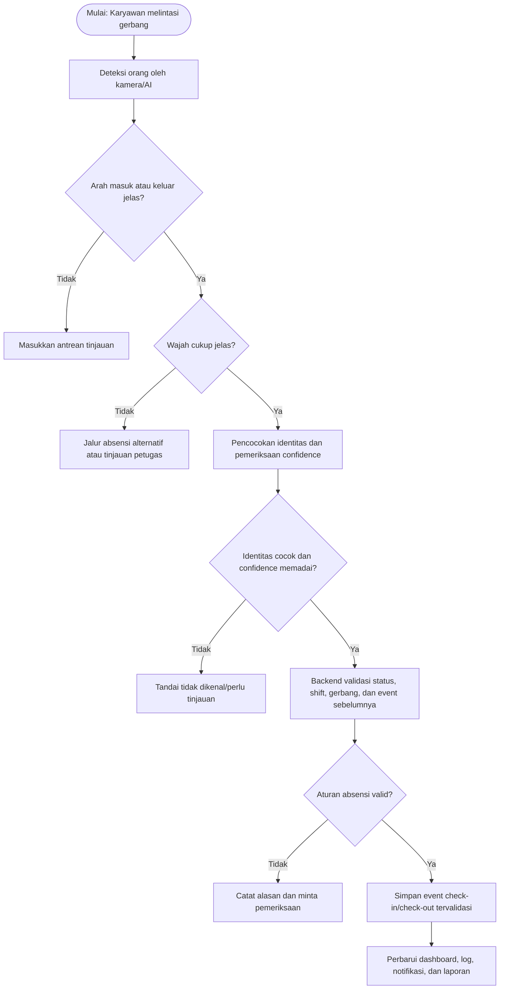

# PlantTrack AI
## Flow Sistem dan Alur Pengguna
**Versi:** 1.0

## 1. Gambaran Alur Sistem

Alur utama menghubungkan kamera gerbang, layanan pemrosesan video/AI, backend absensi, dan website PlantTrack AI.

1. Kamera di gerbang aktif dan mengirim video ke layanan pemrosesan yang berada di jaringan yang diizinkan.
2. Layanan mendeteksi orang yang melintasi area pemantauan.
3. Sistem menentukan arah lintasan menggunakan konfigurasi zona/garis virtual, kamera masuk/keluar yang terpisah, atau sensor akses.
4. Jika wajah terlihat memadai, layanan AI melakukan pencocokan terhadap identitas yang telah terdaftar.
5. Backend memeriksa identitas, status karyawan, gerbang, shift, jadwal, dan catatan absensi hari kerja.
6. Backend menerapkan aturan deduplikasi agar satu lintasan tidak tercatat berkali-kali.
7. Jika valid, backend membuat check-in atau check-out dan mengirim pembaruan ke dashboard.
8. Jika tidak pasti, sistem membuat item tinjauan manual tanpa membuat keputusan otomatis yang berdampak pada karyawan.

## 2. Diagram Alur Kejadian CCTV

## 3. Aturan Keputusan Check-in dan Check-out

| Kondisi | Hasil yang diharapkan |
|---|---|
| Arah masuk + identitas cocok + jadwal valid + belum check-in | Buat event check-in. |
| Arah keluar + identitas cocok + sudah check-in + belum check-out | Buat event check-out. |
| Identitas tidak dikenal atau confidence rendah | Buat item tinjauan; jangan mengaitkan ke karyawan secara otomatis. |
| Arah tidak dapat ditentukan | Tinjauan manual atau gunakan sensor/konfigurasi gerbang tambahan. |
| Event duplikat dalam jendela waktu | Abaikan sebagai duplikat dan simpan jejak teknis sesuai kebijakan. |
| Karyawan tidak memiliki shift aktif | Tandai perlu pemeriksaan; jangan membuat kesimpulan pelanggaran. |
| Kamera offline atau waktu tidak sinkron | Tandai gangguan perangkat dan tahan event yang tidak dapat diverifikasi. |

## 4. Flow Navigasi Website

| Menu | Halaman turunan / tindakan |
|---|---|
| Dashboard | Ringkasan, grafik, aktivitas terbaru, peringatan |
| Peta Area | Pilih pabrik, lihat area, gerbang, kamera, buka detail marker |
| Monitoring CCTV | Daftar kamera, detail kamera, status koneksi, event terkait |
| Karyawan | Daftar, tambah, edit, detail, riwayat kehadiran, nonaktifkan |
| Absensi | Daftar event, filter, detail, tinjau, koreksi |
| Shift | Daftar shift, tambah/edit, kalender penugasan |
| Struktur Pabrik | Pabrik, departemen, area, gerbang, kamera |
| AI Analytics | Ringkasan, tren, anomali, perbandingan |
| AI Assistant | Tanya data, lihat jawaban dan rentang data yang digunakan |
| Laporan | Pilih periode/filter, pratinjau, ekspor |
| Notifikasi | Daftar, filter, tandai dibaca, buka kejadian |
| Pengaturan | Profil, role demo, bahasa, tema, preferensi |

## 5. Flow Review Manual

1. Kejadian berstatus **Perlu Tinjauan** muncul pada daftar review.
2. Petugas membuka detail kejadian.
3. Sistem menampilkan waktu, kamera, gerbang, arah yang terdeteksi, hasil pencocokan, dan alasan peninjauan.
4. Petugas membandingkan informasi dengan sumber yang diizinkan dan kebijakan internal.
5. Petugas memilih konfirmasi, tolak, atau eskalasi.
6. Petugas wajib mengisi alasan untuk keputusan yang mengubah status.
7. Sistem menyimpan identitas petugas, waktu, alasan, dan perubahan pada audit log.

## 6. Flow Pengaturan Kamera dan Gerbang

1. Admin memilih pabrik dan membuka menu Struktur Pabrik.
2. Admin membuat atau memilih gerbang.
3. Admin mendaftarkan kamera dan mengaitkannya dengan gerbang serta area.
4. Admin menentukan fungsi kamera: jalur masuk, jalur keluar, atau pemantauan area.
5. Admin mengatur zona/garis virtual dan menguji arah lintasan.
6. Sistem menampilkan status koneksi dan waktu terakhir kamera aktif.
7. Admin melakukan uji penerimaan sebelum kamera dipakai untuk absensi produksi.

## 7. Kondisi Pengecualian yang Wajib Ditangani

| Kasus | Respons sistem |
|---|---|
| Wajah tertutup masker/helm atau tidak terlihat | Tidak memaksakan identifikasi; gunakan jalur alternatif. |
| Dua orang berjalan berdekatan | Tandai potensi multi-person/ambigu dan minta verifikasi. |
| Foto/video ditunjukkan ke kamera | Gunakan pemeriksaan liveness yang tervalidasi; jangan mengklaim anti-spoofing sempurna. |
| Karyawan masuk lalu berbalik | Gunakan arah lintasan dan aturan gerbang, bukan sekadar deteksi wajah. |
| Karyawan lupa check-out | Tampilkan anomali untuk koreksi HRD, bukan mengarang jam pulang. |
| Kamera mati | Buat notifikasi perangkat; sediakan prosedur absensi alternatif. |
| Jaringan putus | Tandai event tertunda dan sinkronkan setelah koneksi pulih dengan urutan waktu yang dapat diaudit. |
| Shift malam | Hitung rentang shift lintas tanggal secara benar. |
| Satu wajah cocok dengan lebih dari satu identitas | Tolak keputusan otomatis dan minta pemeriksaan. |

## 8. Flow Karyawan dan HRD

### Karyawan

- Menerima informasi cara kerja absensi dan pemberitahuan privasi.
- Melakukan pendaftaran identitas melalui proses resmi yang ditetapkan perusahaan.
- Menggunakan jalur kamera atau metode alternatif yang tersedia.
- Melihat riwayat kehadiran dan mengajukan koreksi sesuai kewenangan.

### HRD

- Memantau ringkasan kehadiran dan event yang perlu ditinjau.
- Memeriksa keterlambatan, event tidak lengkap, dan laporan.
- Menyetujui koreksi dengan alasan yang tercatat.
- Mengelola jadwal shift dan data karyawan sesuai kewenangan.

## 9. Data yang Mengalir

| Sumber | Data | Tujuan |
|---|---|---|
| Kamera | Video stream, camera_id, timestamp | Layanan pemrosesan video |
| AI video | Deteksi orang, arah lintasan, hasil pencocokan, confidence | Backend untuk validasi |
| Backend | Employee ID, shift, event type, status, audit metadata | Database dan dashboard |
| Dashboard | Ringkasan, event, status perangkat, laporan | Pengguna sesuai role |

## 10. Catatan Implementasi

- Browser tidak sebaiknya mengakses stream RTSP secara langsung. Gunakan layanan backend/gateway video yang aman untuk menyediakan tampilan web bila diperlukan.
- Jangan menaruh kredensial kamera, token, atau kunci API di kode frontend.
- Gunakan data demonstrasi untuk membangun dan menguji frontend sebelum perangkat nyata tersedia.
- Tentukan target latensi, jumlah kamera, resolusi, frame rate, dan kapasitas server setelah survei lokasi.
- Lakukan pilot terbatas dan evaluasi akurasi pada kondisi pabrik nyata sebelum memperluas penggunaan.
